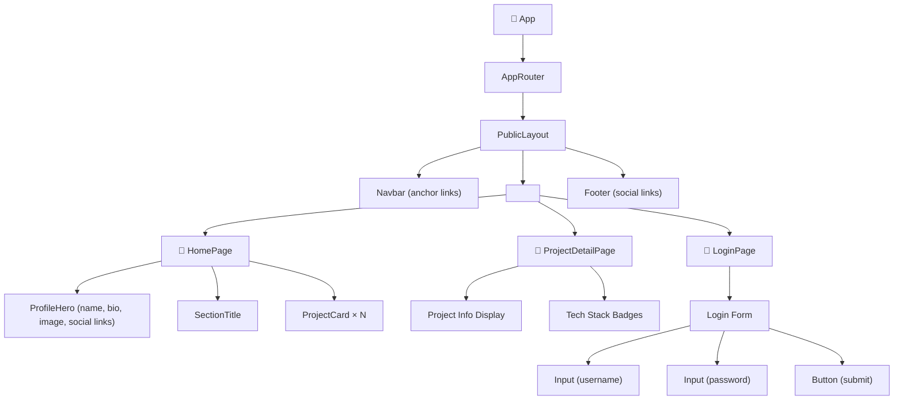
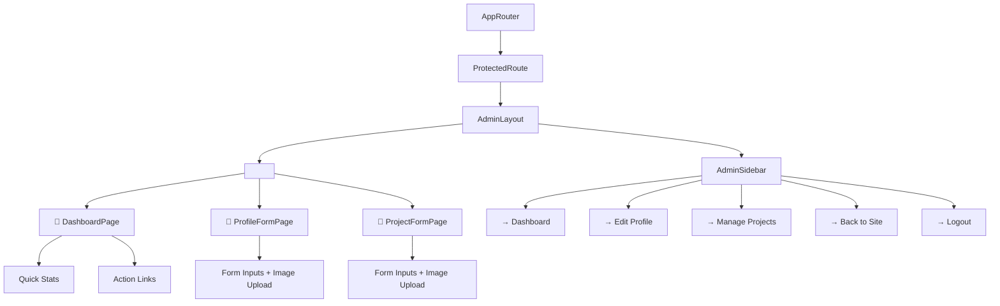
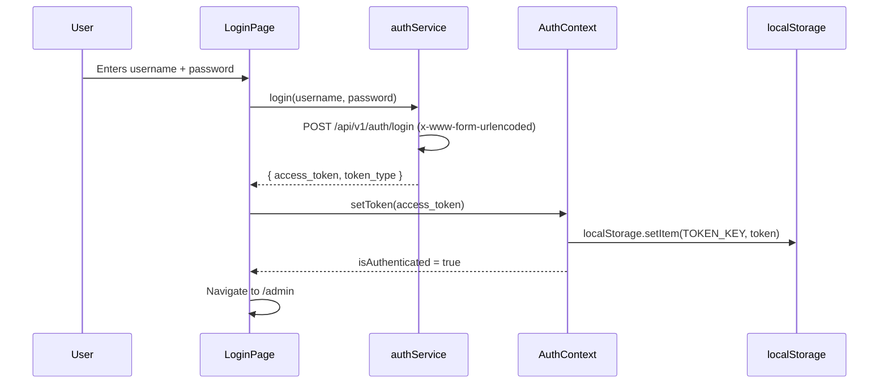

# 🏗️ Itzik's Developer Portfolio — Frontend Architecture Plan

## Architectural Decisions (Finalized)

| Decision             | Choice                                          | Rationale                                                            |
| -------------------- | ----------------------------------------------- | -------------------------------------------------------------------- |
| **Navigation**       | Single page with anchor links (scroll sections) | Simpler UX for a portfolio — one smooth scroll experience            |
| **Contact**          | No form — social/email links in Hero + Footer   | API has no contact endpoint; links are sufficient                    |
| **Dark Mode**        | Skipped entirely — light theme only             | Reduces complexity; can be added later                               |
| **Admin Layout**     | Separate layout with sidebar navigation         | Clear visual separation between public site and admin panel          |
| **Token Storage**    | `localStorage` (not cookies)                    | Simple, works well with SPA + `Authorization: Bearer` header pattern |
| **HTTP Client**      | Native `fetch()` via custom `apiClient.ts`      | KISS — no Axios dependency needed                                    |
| **State Management** | `AuthContext` (global) + custom hooks (local)   | No Redux/Zustand — project scope doesn't justify it                  |
| **Styling**          | Tailwind CSS v4 exclusively                     | Per project rules in GEMINI.md                                       |

---

## Current Project State

```
src/
├── main.tsx                    # Entry point — renders <App />
├── App.tsx                     # Root — AuthProvider + AppRouter
├── index.css                   # @import "tailwindcss"
│
├── types/                      # ✅ Phase 0 — Complete
│   ├── auth.ts                 #    Token, LoginRequest
│   ├── profile.ts              #    PersonalInfoResponse, PersonalInfoCreate, PersonalInfoUpdate
│   ├── project.ts              #    ProjectResponse, ProjectCreate, ProjectUpdate
│   └── api.ts                  #    ValidationError, HTTPValidationError, ApiError
│
├── config/                     # ✅ Phase 0 — Complete
│   └── constants.ts            #    API_BASE_URL, IMAGE_BASE_URL, TOKEN_KEY (env vars)
│
├── services/                   # ✅ Phase 0 — Complete
│   ├── apiClient.ts            #    Base fetch wrapper (FormData-aware + token helpers)
│   ├── authService.ts          #    login() — uses URLSearchParams (OAuth2 flow)
│   ├── profileService.ts       #    getProfile(), upsertProfile(), uploadProfileImage()
│   └── projectService.ts       #    CRUD + uploadProjectImage()
│
├── context/                    # ✅ Phase 1.1 — Complete
│   └── AuthContext.tsx          #    AuthProvider + useAuthContext
│
├── hooks/                      # ✅ Phase 1.2 — Complete
│   └── useAuth.ts               #    handleLogin/handleLogout + loading/error state
│
└── router/                     # ✅ Phase 1.3-1.4 — Complete
    ├── ProtectedRoute.tsx       #    Auth guard — redirects to /login if unauthenticated
    └── AppRouter.tsx            #    Full route tree (public + admin) with temp stubs
```

### Key Implementation Details

> [!IMPORTANT]
> **FormData Content-Type Fix:** [`apiClient.ts`](../src/services/apiClient.ts) does NOT hardcode `Content-Type: application/json`. When the body is `FormData`, it skips the header entirely — the browser sets `multipart/form-data` with the correct boundary automatically. This is critical for image uploads in Phases 4+.

> [!NOTE]
> **Auth Service Exception:** [`authService.ts`](../src/services/authService.ts) uses direct `fetch()` instead of `apiRequest`, because the login endpoint requires `application/x-www-form-urlencoded` (OAuth2 password flow), not JSON.

> [!NOTE]
> **TOKEN_KEY Centralized:** The localStorage key `"portfolio_auth_token"` is defined once in [`constants.ts`](../src/config/constants.ts) and imported by [`apiClient.ts`](../src/services/apiClient.ts). [`AuthContext.tsx`](../src/context/AuthContext.tsx) accesses it indirectly via the token helper functions in `apiClient`.

> [!NOTE]
> **Environment Variables:** `API_BASE_URL` and `IMAGE_BASE_URL` in [`constants.ts`](../src/config/constants.ts) are loaded from `VITE_API_BASE_URL` and `VITE_IMAGE_BASE_URL` env vars via a fail-fast `getRequiredEnvVar()` helper. A `.env` file must exist locally (tracked in `.gitignore`).

---

## Target Folder Structure (Full)

```
src/
├── main.tsx
├── App.tsx
├── index.css
│
├── types/                       # ✅ Done
│   ├── auth.ts
│   ├── profile.ts
│   ├── project.ts
│   └── api.ts
│
├── config/                      # ✅ Done
│   └── constants.ts
│
├── services/                    # ✅ Done
│   ├── apiClient.ts
│   ├── authService.ts
│   ├── profileService.ts
│   └── projectService.ts
│
├── hooks/                       # 🔲 Phase 1 + 3 (useAuth ✅)
│   ├── useAuth.ts               #    ✅ handleLogin/handleLogout + loading/error state
│   ├── useProfile.ts            #    Fetch & cache profile data
│   └── useProjects.ts           #    Fetch & cache projects data
│
├── context/                     # ✅ Done (Phase 1.1)
│   └── AuthContext.tsx           #    AuthProvider + useAuthContext
│
├── components/                  # 🔲 Phase 2 + 3 + 4
│   ├── layout/                  #    Public layout shell
│   │   ├── Navbar.tsx           #    Top nav with anchor links (Home, Projects, Contact)
│   │   ├── Footer.tsx           #    Social links (GitHub, LinkedIn, Email)
│   │   └── PublicLayout.tsx     #    Navbar + <Outlet /> + Footer
│   │
│   ├── admin/                   #    Admin layout shell (SEPARATE from public)
│   │   ├── AdminSidebar.tsx     #    Sidebar navigation (Dashboard, Profile, Projects)
│   │   └── AdminLayout.tsx      #    Sidebar + <Outlet /> (no Navbar/Footer)
│   │
│   ├── ui/                      #    Generic UI primitives
│   │   ├── Button.tsx
│   │   ├── Card.tsx
│   │   ├── Input.tsx
│   │   ├── Loader.tsx           #    Spinner / skeleton
│   │   └── SectionTitle.tsx     #    Reusable section header
│   │
│   └── shared/                  #    Domain-aware shared components
│       ├── ProjectCard.tsx      #    Single project display card
│       └── ProfileHero.tsx      #    Hero section with profile info + social links
│
├── pages/                       # 🔲 Phase 1 + 3 + 4
│   ├── HomePage.tsx             #    Single-page: Hero + Projects sections (anchor scroll)
│   ├── ProjectDetailPage.tsx    #    Single project deep-dive (/projects/:id)
│   ├── LoginPage.tsx            #    Admin login form
│   └── admin/                   #    Protected admin pages
│       ├── DashboardPage.tsx    #    Admin overview + action links
│       ├── ProfileFormPage.tsx  #    Edit profile + upload image
│       └── ProjectFormPage.tsx  #    Create/Edit project + upload image
│
└── router/                      # ✅ Done
    ├── AppRouter.tsx            #    ✅ Route definitions
    └── ProtectedRoute.tsx       #    ✅ Auth guard wrapper
```

---

## Component Hierarchy

### Public Site



### Admin Panel (Separate Layout)



### Routing Map

| Route                      | Layout       | Component           | Auth? | Description                                        |
| -------------------------- | ------------ | ------------------- | ----- | -------------------------------------------------- |
| `/`                        | PublicLayout | `HomePage`          | ❌    | Landing — Hero (with social links) + Projects grid |
| `/projects/:id`            | PublicLayout | `ProjectDetailPage` | ❌    | Project deep-dive                                  |
| `/login`                   | PublicLayout | `LoginPage`         | ❌    | Admin login form                                   |
| `/admin`                   | AdminLayout  | `DashboardPage`     | ✅    | Admin dashboard                                    |
| `/admin/profile`           | AdminLayout  | `ProfileFormPage`   | ✅    | Edit personal info                                 |
| `/admin/projects/new`      | AdminLayout  | `ProjectFormPage`   | ✅    | Create new project                                 |
| `/admin/projects/:id/edit` | AdminLayout  | `ProjectFormPage`   | ✅    | Edit existing project                              |

---

## TypeScript Types — API Contract Mapping

### [`types/auth.ts`](../src/types/auth.ts)

```
LoginRequest: { username: string, password: string }
Token:        { access_token: string, token_type: string }
```

### [`types/profile.ts`](../src/types/profile.ts)

```
PersonalInfoResponse: { id, first_name, last_name, birth_date?, bio?, image_url? }
PersonalInfoCreate:   { first_name, last_name, birth_date?, bio? }
PersonalInfoUpdate:   { first_name?, last_name?, birth_date?, bio? }
```

### [`types/project.ts`](../src/types/project.ts)

```
ProjectResponse: { id, title, description, github_url?, live_url?, tech_stack?, display_order?, image_url? }
ProjectCreate:   { title, description, github_url?, live_url?, tech_stack?, display_order? }
ProjectUpdate:   { title?, description?, github_url?, live_url?, tech_stack?, display_order? }
```

### [`types/api.ts`](../src/types/api.ts)

```
ValidationError:     { loc: (string|number)[], msg, type }
HTTPValidationError: { detail: ValidationError[] }
ApiError:            { status: number, message: string, validationErrors?: ValidationError[] }
```

---

## Services — API Endpoint Mapping

| Service File                                             | Function                       | HTTP   | Endpoint                     | Auth? |
| -------------------------------------------------------- | ------------------------------ | ------ | ---------------------------- | ----- |
| [`authService.ts`](../src/services/authService.ts)       | `login(credentials)`           | POST   | `/auth/login`                | ❌    |
| [`profileService.ts`](../src/services/profileService.ts) | `getProfile()`                 | GET    | `/profile/`                  | ❌    |
|                                                          | `upsertProfile(data)`          | PUT    | `/profile/`                  | ✅    |
|                                                          | `uploadProfileImage(file)`     | POST   | `/profile/upload-image`      | ✅    |
| [`projectService.ts`](../src/services/projectService.ts) | `getAllProjects()`             | GET    | `/projects/`                 | ❌    |
|                                                          | `getProject(id)`               | GET    | `/projects/:id`              | ❌    |
|                                                          | `createProject(data)`          | POST   | `/projects/`                 | ✅    |
|                                                          | `updateProject(id, data)`      | PATCH  | `/projects/:id`              | ✅    |
|                                                          | `deleteProject(id)`            | DELETE | `/projects/:id`              | ✅    |
|                                                          | `uploadProjectImage(id, file)` | POST   | `/projects/:id/upload-image` | ✅    |

---

## State Management Strategy

| State                       | Tool                 | Scope    | Why                                                 |
| --------------------------- | -------------------- | -------- | --------------------------------------------------- |
| Auth (token + login status) | `AuthContext`        | Global   | Needed everywhere: Navbar, ProtectedRoute, services |
| Profile data                | `useProfile()` hook  | Per-page | Only needed in HomePage, ProfileFormPage            |
| Projects data               | `useProjects()` hook | Per-page | Only needed in HomePage, ProjectFormPage            |

### Auth Flow



---

## Dependencies

| Package             | Version | Purpose                        |
| ------------------- | ------- | ------------------------------ |
| `react`             | ^19.2.8 | UI library                     |
| `react-dom`         | ^19.2.8 | DOM renderer                   |
| `react-router-dom`  | ^7.18.3 | Client-side routing            |
| `tailwindcss`       | ^4.3.3  | Utility-first CSS (dev)        |
| `@tailwindcss/vite` | ^4.3.3  | Vite plugin for Tailwind (dev) |

> [!NOTE]
> **That's it.** No Axios, no Redux, no Zustand, no React Hook Form. KISS principle — we build with built-ins first.

---

## Step-by-Step Roadmap

### ✅ Phase 0: Foundation — COMPLETE

- [x] **0.1** — Install `react-router-dom`
- [x] **0.2** — Create `types/` folder — define all TypeScript interfaces from API contract
- [x] **0.3** — Create `config/constants.ts` — `API_BASE_URL`, `IMAGE_BASE_URL`
- [x] **0.4** — Create `services/apiClient.ts` — base fetch wrapper
- [x] **0.5** — Create `services/authService.ts`, `profileService.ts`, `projectService.ts`

**🎓 React Concepts to teach:** None yet — this is pure TypeScript.

---

### 🔲 Phase 1: Auth System

> **Goal:** Full login flow with protected routes.

- [x] **1.1** — Create `context/AuthContext.tsx` — AuthProvider with token state + localStorage
- [x] **1.2** — Create `hooks/useAuth.ts` — login/logout functions consuming authService
- [x] **1.3** — Create `router/ProtectedRoute.tsx` — redirects to `/login` if not authenticated
- [x] **1.4** — Create `router/AppRouter.tsx` — full route config (public + admin)
- [x] **1.5** — Update `App.tsx` — wrap with AuthProvider + AppRouter
- [ ] **1.6** — Create `pages/LoginPage.tsx` — login form with error handling

**🎓 Concepts:** `createContext`, `useContext`, `useState`, `useEffect`, localStorage, conditional rendering.

---

### 🔲 Phase 2: Layout Shell

> **Goal:** Build the visual frame for both public site and admin panel.

- [ ] **2.1** — Create `components/ui/Button.tsx` — reusable button with variants
- [ ] **2.2** — Create `components/ui/Loader.tsx` — spinner/loading indicator
- [ ] **2.3** — Create `components/layout/Navbar.tsx` — anchor links for single-page scroll
- [ ] **2.4** — Create `components/layout/Footer.tsx` — social links (GitHub, LinkedIn, Email)
- [ ] **2.5** — Create `components/layout/PublicLayout.tsx` — Navbar + `<Outlet />` + Footer
- [ ] **2.6** — Create `components/admin/AdminSidebar.tsx` — sidebar navigation
- [ ] **2.7** — Create `components/admin/AdminLayout.tsx` — Sidebar + `<Outlet />`
- [ ] **2.8** — Update global styles in `index.css` (fonts, base theme)

**🎓 Concepts:** Component composition, props, children, `<Outlet />`, nested routes.

---

### 🔲 Phase 3: Public Pages

> **Goal:** Build what visitors see.

- [ ] **3.1** — Create `hooks/useProfile.ts` — fetches profile data
- [ ] **3.2** — Create `hooks/useProjects.ts` — fetches all projects
- [ ] **3.3** — Create `components/ui/SectionTitle.tsx`
- [ ] **3.4** — Create `components/ui/Card.tsx`
- [ ] **3.5** — Create `components/shared/ProfileHero.tsx` — name, bio, image, social links
- [ ] **3.6** — Create `components/shared/ProjectCard.tsx` — project preview card
- [ ] **3.7** — Create `pages/HomePage.tsx` — Hero + Projects grid (anchor sections)
- [ ] **3.8** — Create `pages/ProjectDetailPage.tsx` — full project view + tech badges

**🎓 Concepts:** `useEffect` for data fetching, loading/error states, `map()` for lists, `useParams()`.

---

### 🔲 Phase 4: Admin Panel

> **Goal:** Build the content management interface.

- [ ] **4.1** — Create `components/ui/Input.tsx` — reusable form input (text, url, date, textarea)
- [ ] **4.2** — Create `pages/admin/DashboardPage.tsx` — admin home with action links
- [ ] **4.3** — Create `pages/admin/ProfileFormPage.tsx` — edit profile + image upload
- [ ] **4.4** — Create `pages/admin/ProjectFormPage.tsx` — create/edit project + image upload

**🎓 Concepts:** Controlled components, `onChange`, `FormData`, create vs. edit mode, `useNavigate()`.

---

### 🔲 Phase 5: Polish & UX

> **Goal:** Make it feel professional.

- [ ] **5.1** — Responsive design review (mobile-first)
- [ ] **5.2** — Error handling UI (toast/notification for API errors)
- [ ] **5.3** — Empty states (no projects yet, no profile yet)
- [ ] **5.4** — Loading skeletons instead of spinners
- [ ] **5.5** — Smooth scroll behavior for anchor links
- [ ] **5.6** — Subtle animations and transitions
- [ ] **5.7** — SEO meta tags (title, description per page)
- [ ] **5.8** — Final cross-browser testing

---

## Verification Plan

### Automated

- `npx tsc -b --noEmit` — TypeScript compiles with zero errors
- `npm run lint` — ESLint passes with zero warnings
- `npm run build` — Production build succeeds

### Manual Testing Checklist

- [ ] **Public flow:** Home → scroll to projects → click project → detail page → back
- [ ] **Auth flow:** `/admin` redirects to `/login` → login → redirected to `/admin`
- [ ] **Profile:** Admin → Edit Profile → save changes → verify on Home page
- [ ] **Projects:** Admin → Create Project → upload image → verify on Home → Edit → Delete → verify removed
- [ ] **Logout:** Admin → Logout → redirected to Home → `/admin` redirects to `/login`
- [ ] **Responsive:** Chrome DevTools — mobile, tablet, desktop
